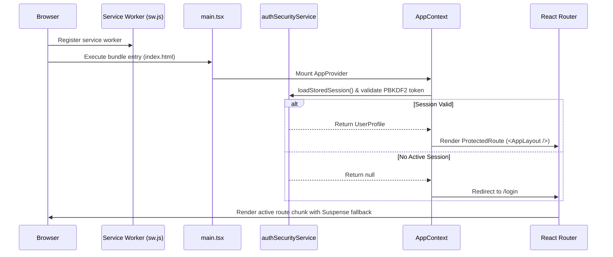

# Application Flow & Lifecycle

## 1. Application Initialization Flow
When the browser loads OFFER MODE, the bootstrap lifecycle executes in the following deterministic sequence:

## 2. Authentication Route Guards
Implemented in [`src/app/router.tsx`](file:///f:/Countdown-Lock-Screen/src/app/router.tsx#L30-L46):
- `ProtectedRoute`: Evaluates `isAuthenticated` from `AppContext`. If unauthenticated, immediately performs client-side redirect to `/login` while preserving target location.
- `GuestRoute`: Prevents authenticated users from seeing `/login` or `/signup`, redirecting them to the main dashboard (`/`).
