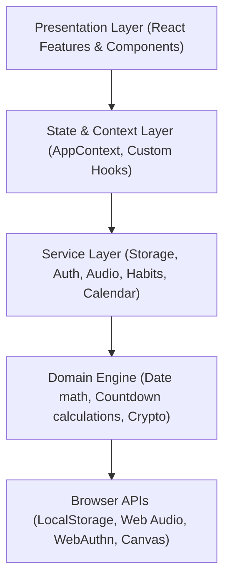

# Frontend Architecture Overview

## 1. Architectural Philosophy
OFFER MODE follows a **Local-First, Modular Domain Architecture** with strict layer separation:

## 2. Layer Definitions
1. **Presentation Layer (`src/features/`, `src/components/`)**: Pure functional components with explicit props. Presentation components never directly mutate storage.
2. **Context & State Layer (`src/store/`, `src/hooks/`)**: Centralized dispatchers managing reactive state updates, user sessions, and theme modes.
3. **Service Layer (`src/services/`)**: Domain-specific singletons handling persistence (`storageService`, `lifeStorageService`), Web Audio soundscapes (`ambientAudioService`), and hardware passkeys (`passkeyService`).
4. **Utility & Engine Layer (`src/utils/`)**: Pure, side-effect-free math functions for RFC 5545 calendar strings, timezone offsets, and countdown precision.
