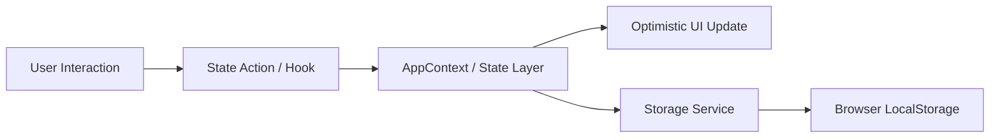

# Data Flow Architecture

## 1. Unidirectional Data Flow

All user interactions trigger state mutations that update React components immediately (optimistic UI), followed by serialization into browser storage.
