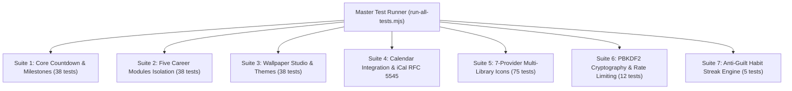

# Comprehensive Testing Strategy

## 1. Testing Architecture
OFFER MODE employs a multi-tiered automated verification architecture centered around `npm test` and executed by [`scratch/run-all-tests.mjs`](file:///f:/Countdown-Lock-Screen/scratch/run-all-tests.mjs).

All 7 suites execute in under 3 seconds with a strict 100% pass requirement before code can be merged or pushed.
