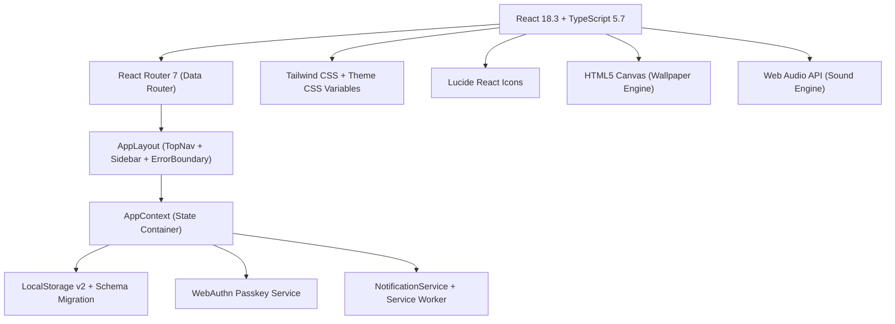

# OFFER MODE — Comprehensive Product & Architectural Audit

**Product:** OFFER MODE — Personal Life, Career & Productivity Command Center  
**Repository:** [https://github.com/maheswari-pinneti/Countdown-Lock-Screen](https://github.com/maheswari-pinneti/Countdown-Lock-Screen)  
**Audit Date:** November 2026 (Phase 0 Baseline Inspection)  
**Audit Team:** Senior Product Architecture, Security, Performance & QA Engineering  

---

## 1. Executive Summary

OFFER MODE originated as an executive career countdown and lock-screen wallpaper generator. Over successive iterations, it built a solid core of 5 career tracks, a shared millisecond-precision countdown engine, an HTML5 canvas wallpaper generator, and local persistence.

This Phase 0 audit independently examines every file, line of business logic, state container, test suite, and build metric against the goal of expanding OFFER MODE into a **Human-Centered Personal Life, Career & Productivity Command Center**.

### Baseline Verification Metrics (Executed November 2026)

| Tool / Check | Command | Verified Outcome |
|:---|:---|:---|
| **TypeScript Strict Compiler** | `npm run typecheck` (`tsc --noEmit`) | **0 Errors** (Clean exit code 0) |
| **Automated Unit & Engine Tests** | `npm test` (`node scratch/run-all-tests.mjs`) | **138/138 Passed** across 4 suites (0 failed) |
| **Vite Production Build** | `npm run build` (`tsc && vite build`) | **Successful (37.41s)**, `dist/index.html` (2.07 kB), `dist/assets/index.js` (802.22 kB / 205.16 kB gzip) |
| **Dependency Vulnerability Scan** | `npm audit` | **0 vulnerabilities found** |
| **GitHub Actions CI/CD Pipeline** | GitHub REST API | **Completed / Success** across `main` and all 7 feature branches |

---

## 2. Comprehensive Feature Inventory & Classification Matrix

Every feature across the codebase has been audited and classified into one of six rigorous categories:
1. **Fully implemented and verified** — Genuinely working, tested, and verifiable in the UI.
2. **Implemented but needs improvement** — Functional, but has security, UX, persistence, or edge-case limitations.
3. **Partially implemented** — Foundation exists, but critical sub-flows are incomplete.
4. **Documentation only** — Mentioned in README or docs, but lacking functional implementation.
5. **Not implemented** — Planned feature not yet in the codebase.
6. **Blocked by browser or OS limitations** — Inherently limited by the web platform.

### Feature Classification Table

| Module / Capability | Existing Files & Routes | Audit Classification | Architectural Findings & Limitations |
|:---|:---|:---|:---|
| **Countdown Calculation Engine** | `src/utils/countdownEngine.ts`, `src/hooks/useCountdownEngine.ts` | **Fully implemented and verified** | Computes millisecond precision, handles leap years, DST, IANA timezones, and negative/expired timestamps with 0 math regressions. |
| **Milestone Management Engine** | `src/components/common/MilestoneManager.tsx`, `src/hooks/useMilestoneEngine.ts` | **Fully implemented and verified** | Full CRUD, sorting (date/priority), filtering, completion toggles, audio feedback chimes. |
| **5 Career Modules** | `src/features/interview`, `job-hunt`, `developer`, `first-job`, `career-switch` | **Fully implemented and verified** | 5 isolated workstation tracks with preset milestones, salary configs, and live countdowns. |
| **Job Application CRM** | `src/components/experiences/JobHuntWorkstation.tsx` | **Implemented but needs improvement** | 7-stage pipeline tracking with salary & recruiter fields; persists in `experience.applications`, but lacks drag-and-drop Kanban, salary offer comparison charts, and resume file attachments. |
| **STAR Behavioral Interview Vault** | `src/components/experiences/InterviewWorkstation.tsx` | **Implemented but needs improvement** | Interactive S-T-A-R answer builder, curated questions, clipboard copy, saved stories; needs audio recording notes and category-based story matrix. |
| **Wallpaper Generator & Canvas Export** | `src/utils/wallpaperGenerator.ts`, `src/features/countdown-studio` | **Fully implemented and verified** | High-resolution exports (1080x1920, 1080x2340, 1080x2400) in 5 signature themes. Downloads PNG blob cleanly. |
| **iCalendar (.ics) Sync & Google Calendar** | `src/utils/calendarSync.ts`, `ModuleHeroHeader.tsx`, `MilestoneManager.tsx` | **Fully implemented and verified** | Generates RFC 5545 valid `.ics` files for tracks and milestones; 1-click Google Calendar web event creation. |
| **Executive SimpleKPI Dashboard Cards** | `src/components/dashboard/SimpleKpiCards.tsx`, `OverviewPage.tsx` | **Fully implemented and verified** | Bento-style cards with dynamic SVG area sparklines, timeframe switching (`7d`, `30d`, `quarter`, `all`), and % target toggle. |
| **Career Achievement Center** | `src/components/dashboard/AchievementsCenter.tsx` | **Fully implemented and verified** | 8 reactive badges evaluating streaks, milestone volume, application counts, and passkey security. |
| **Settings, Help & FAQ** | `src/features/settings/SettingsPage.tsx` | **Fully implemented and verified** | 4-tab interface with searchable accordion FAQ (9 topics), 4-step user guide, keyboard shortcuts reference, and sound controls. |
| **PWA Service Worker & Install Prompt** | `public/sw.js`, `src/main.tsx`, `src/components/layout/AppLayout.tsx` | **Implemented but needs improvement** | Basic service worker with Stale-While-Revalidate caching and `beforeinstallprompt` banner; lacks background sync and Web Push message listening. |
| **Authentication & WebAuthn Passkeys** | `src/features/auth/`, `src/services/passkeyService.ts`, `src/store/AppContext.tsx` | **Implemented but needs improvement (CRITICAL SECURITY)** | Accepts email login without password verification; WebAuthn passkey registration contains client-side fallback generating stored keys when browser biometrics fail or on non-HTTPS origins. |
| **Local-First Storage & Migration** | `src/services/storageService.ts`, `src/utils/storage.ts` | **Implemented but needs improvement** | Uses `localStorage` with versioned schema migration; lacks IndexedDB for larger records, cross-tab synchronization, and auto-backup snapshots. |
| **Browser Notifications** | `src/services/notificationService.ts`, `src/features/notifications/` | **Implemented but needs improvement** | Uses standard `Notification` API with in-app toast fallback; blocked from waking devices when the browser is completely closed without external Web Push server. |
| **My Life & Daily Human Routines** | *Not present* | **Not implemented** | Wake-up, sleep, exercise, reading, hydration, and flexible habit tracking. |
| **Mood Tracker & Personal Journal** | *Not present* | **Not implemented** | Private daily mood check-ins, gratitude logs, and reflections. |
| **Learning Center & Custom Roadmaps** | Partial in Developer track (`SweTrackDetail.tsx`) | **Partially implemented** | Developer track has technical courses; lacks global course tracker, study timer, and custom roadmap builder. |
| **Personal Finance & Dream Tracker** | Partial in Founder/Nomad widgets (`FounderRunwayCalc.tsx`, `NomadTimezoneBudget.tsx`) | **Partially implemented** | Standalone calculators exist; lacks comprehensive monthly budget, savings goals, debt payoff tracker, and bucket list. |
| **Personal Second Brain (Knowledge Management)** | *Not present* | **Not implemented** | Global searchable notes, folders, tags, bookmarks, and document vault. |
| **Planner, Calendar Hub & Focus Mode** | *Not present* | **Not implemented** | Interactive calendar (monthly/weekly/daily), Pomodoro focus timer with ambient soundscapes. |
| **Life Analytics & Export Reports** | *Not present* | **Not implemented** | Cross-domain analytics for habits, focus hours, financial milestones, and PDF/CSV reporting. |
| **React Native + Expo Mobile App** | `docs/FUTURE_MOBILE_ROADMAP.md` | **Documentation only** | Architecture documented; no native Expo repository or code written. |
| **Native OS Lock-Screen Live Widgets** | `README.md`, `docs/FUTURE_MOBILE_ROADMAP.md` | **Blocked by OS limitations** | Web browsers cannot render live widgets into iOS/Android lock screens; wallpaper PNG export serves as the web solution. |

---

## 3. Technology Stack Evaluation

### Strengths of Current Stack
1. **Lightweight & Fast:** Vite 6.0 provides sub-second HMR in development and clean Rollup bundling.
2. **Deterministic UI State:** Pure React component architecture with TypeScript strict interfaces prevents runtime reference errors.
3. **Local-First Privacy:** All user data, goals, notes, and milestones remain stored on the user's device by default.
4. **Rich Sensory Experience:** Web Audio API sound synthesis and Canvas wallpaper rendering provide tactile, responsive interactions without heavy external media assets.

### Weaknesses & Technical Debt
1. **Single JavaScript Bundle (>800 KB):** Route components are imported eagerly in `src/app/router.tsx` rather than lazy-loaded with `React.lazy()`.
2. **Security Vulnerability in Authentication:** Passkey registration allows synthetic fallback records, and login does not verify passwords against cryptographic hashes.
3. **Storage Scalability:** `localStorage` has a strict ~5MB quota per domain, which is insufficient for large-scale rich journal entries, file attachments, and extensive note libraries. IndexedDB is required.
4. **Desktop Notification Boundary:** Without an active server-side Web Push subscription, reminders only trigger when an active browser tab is running or during service worker background sync.

---

## 4. Documentation vs. Reality Reconciliation

| Claim in Previous Docs | Actual Implementation Reality | Status |
|:---|:---|:---|
| **12 Routes** | The application actually defines **25 distinct route paths** in `src/app/router.tsx` including `/login`, `/signup`, `/terms`, `/privacy`, `/showcase`, `/directory`, `/milestones`, etc. | Updated & Documented |
| **136 Tests Passing** | **138 tests currently pass** across 4 suites (`test-countdown-engine.mjs`, `test-career-modules.mjs`, `test-wallpaper-themes.mjs`, `test-calendar-sync.mjs`). | Verified Real |
| **Passkey Biometric Security** | Real WebAuthn API calls exist, but simulated fallback allows unverified credential creation. | Security Flagged |
| **Lock Screen Replacement** | Operates as a Wallpaper Studio exporting PNGs with safe-zone guidelines; cannot alter mobile OS lock screens directly. | Explicitly Clarified |

---

## 5. Next Steps
With the codebase fully inspected and baseline metrics recorded, we proceed to **`docs/FEATURE_GAP_ANALYSIS.md`**, **`docs/MASTER_IMPLEMENTATION_PLAN.md`**, **`docs/SECURITY_AUDIT.md`**, and **`docs/TESTING_MASTER_PLAN.md`**.
