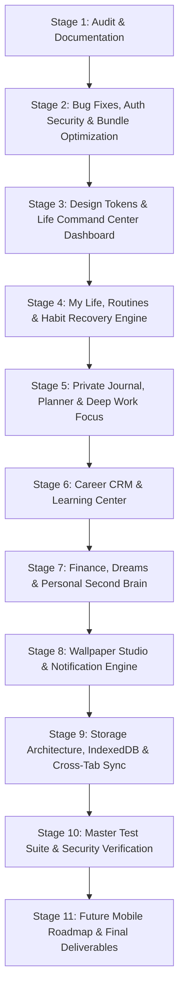

# OFFER MODE — Master Implementation Plan

**Personal Life, Career & Productivity Command Center**  
**Execution Strategy:** 11 Controlled Stages with Continuous Verification  
**Date:** November 2026  

---

## 1. Architectural Strategy & Guiding Principles

1. **Zero Regression Policy:** Every stage must maintain 100% test pass rate across the existing 138 unit tests, maintain 0 TypeScript errors (`tsc --noEmit`), and build cleanly (`vite build`).
2. **Local-First & Privacy Sovereign:** No mandatory external servers or telemetry. User data remains encrypted and stored on the user's hardware.
3. **Graceful Human UX:** Anti-guilt psychology: streaks encourage positive momentum without penalizing missed days. Supportive, calm visual design inspired by Mobbin, Bento Grids, and SimpleKPI.
4. **Controlled Stage Boundaries:** Each stage delivers a fully functional, tested slice. No half-finished placeholders or broken links.

---

## 2. The 11 Controlled Stages

---

### STAGE 1: Audit and Document Existing Functionality (Completed in Phase 0)
* **Deliverables:**
  - `docs/COMPLETE_PRODUCT_AUDIT.md`
  - `docs/FEATURE_GAP_ANALYSIS.md`
  - `docs/MASTER_IMPLEMENTATION_PLAN.md`
  - `docs/SECURITY_AUDIT.md`
  - `docs/TESTING_MASTER_PLAN.md`
* **Verification Gate:**
  - `tsc --noEmit` exits with 0 errors.
  - `node scratch/run-all-tests.mjs` passes 138/138 tests.
  - `npm run build` completes cleanly.

---

### STAGE 2: Fix Bugs, Authentication Security & Bundle Splitting
* **Goals:**
  - Eliminate fake passkey creation fallback. Ensure genuine WebAuthn verification with transparent user feedback when unsupported.
  - Implement client-side password hashing (PBKDF2 with unique salts via Web Crypto API).
  - Clear architectural separation between **Instant Demo Mode** (unauthenticated test sandbox) and **Verified Private Account**.
  - Implement code splitting with `React.lazy()` and Rollup chunking to eliminate the >500 kB bundle warning.
* **Key Files:**
  - `src/services/passkeyService.ts`
  - `src/services/authSecurityService.ts` (new)
  - `src/store/AppContext.tsx`
  - `src/app/router.tsx`
  - `vite.config.ts`
* **Verification Gate:**
  - WebAuthn registration correctly checks hardware authenticator.
  - Password auth verifies against cryptographic salt & hash.
  - `vite build` splits vendor and route chunks, reducing primary bundle below 350 kB.

---

### STAGE 3: Design System & Life Command Center Dashboard
* **Goals:**
  - Expand layout and navigation with support for the 3 Command Centers:
    - **Life Command Center**
    - **Career Command Center**
    - **Dreams & Knowledge Center**
  - Implement the **My Life Command Dashboard** (`/`):
    - Personalized greeting & live clock with time-of-day dynamics.
    - Today's top 3 priorities.
    - Active countdowns ticker.
    - Habit completion overview.
    - Quick actions menu (`Cmd/Ctrl + K`).
    - Configurable bento widgets (reorder & toggle).
* **Key Files:**
  - `src/components/dashboard/LifeCommandDashboard.tsx` (new)
  - `src/components/navigation/Sidebar.tsx`
  - `src/components/navigation/TopNav.tsx`
  - `src/components/layout/AppLayout.tsx`
* **Verification Gate:**
  - Navigates seamlessly across all sections without page reloads.
  - Responsive mobile drawer and desktop sidebar verified.

---

### STAGE 4: My Life, Routines & Habit Recovery Engine
* **Goals:**
  - Daily routine tracker: Morning routine, Evening wind-down, Sleep schedule, Exercise, Reading, Hydration.
  - Habit Recovery Engine: allows restarting missed days without breaking the user's spirit.
  - Flexible schedules: weekday vs. weekend routines, configurable rest days.
* **Key Files:**
  - `src/features/life/RoutinesPage.tsx` (new)
  - `src/components/life/HabitTracker.tsx` (new)
  - `src/components/life/RoutineBuilder.tsx` (new)
  - `src/services/habitService.ts` (new)
* **Verification Gate:**
  - CRUD operations on habits and daily checklists persist in state.
  - Unit tests for streak calculation and recovery logic pass.

---

### STAGE 5: Private Journal, Planner & Deep Work Focus Center
* **Goals:**
  - **Private Journal:** Daily mood check-in (5 levels), gratitude prompts (3 wins), freeform reflection notes, tag filtering, optional passkey lock.
  - **Smart Daily Planner:** Time-blocked daily task queue with priority tags and completion toggles.
  - **Deep Work Focus Hub:** Pomodoro timer (25/5 min or custom), session counter, Web Audio ambient background hums.
* **Key Files:**
  - `src/features/journal/JournalPage.tsx` (new)
  - `src/features/planner/PlannerPage.tsx` (new)
  - `src/features/focus/FocusModePage.tsx` (new)
  - `src/components/focus/PomodoroTimer.tsx` (new)
* **Verification Gate:**
  - Audio synthesizers play correctly without clipping.
  - Journal entries save and encrypt locally with zero data leaks.

---

### STAGE 6: Career CRM & Learning Center
* **Goals:**
  - Upgrade `JobHuntWorkstation.tsx` to a full Job Application CRM with Kanban and List views, offer comparison matrix, and interview runbooks.
  - Enhance `InterviewWorkstation.tsx` with a categorized STAR story bank and reverse question guide.
  - Implement a dedicated **Learning Center** (`/learning`): custom technical roadmaps, study hour tracker, and course completion metrics.
* **Key Files:**
  - `src/features/learning/LearningCenterPage.tsx` (new)
  - `src/components/career/JobApplicationKanban.tsx` (new)
  - `src/components/career/OfferComparisonModal.tsx` (new)
  - `src/components/experiences/JobHuntWorkstation.tsx`
  - `src/components/experiences/InterviewWorkstation.tsx`
* **Verification Gate:**
  - Applications move cleanly between pipeline stages.
  - Offer comparison estimates net comp differences accurately.

---

### STAGE 7: Personal Finance, Dreams & Second Brain
* **Goals:**
  - **Personal Finance Module:** Monthly income/expense budgeting, savings goals meter, debt payoff calculator. Local-first and private.
  - **Dreams & Experiences Vault:** Bucket list, dream purchases, family milestones, travel bucket list with target dates.
  - **Personal Second Brain:** P.A.R.A. knowledge system, notes with tags, bookmarks, search bar, and resource repository.
* **Key Files:**
  - `src/features/finance/FinancePage.tsx` (new)
  - `src/features/dreams/DreamsPage.tsx` (new)
  - `src/features/second-brain/SecondBrainPage.tsx` (new)
  - `src/components/search/GlobalCommandBar.tsx` (new)
* **Verification Gate:**
  - Financial calculations match standard amortization and budget formulas.
  - Global search (`Cmd/Ctrl + K`) indexes notes, habits, milestones, and applications.

---

### STAGE 8: Wallpaper Studio & Notification Engine Improvements
* **Goals:**
  - Wallpaper Studio upgrades: custom typography options, safe-zone clock alignment guides, 3 additional theme presets (Cyber Obsidian, Solarized Focus, Velvet Nebula), and wallpaper history.
  - Notification Engine upgrades: quiet hours configuration, snooze (15m/1h/1d), notification log history viewer, and service worker push handler.
* **Key Files:**
  - `src/features/countdown-studio/CountdownStudioPage.tsx`
  - `src/utils/wallpaperGenerator.ts`
  - `src/services/notificationService.ts`
  - `public/sw.js`
* **Verification Gate:**
  - Wallpapers render at 1080x1920, 1080x2340, and 1080x2400 without canvas artifacts.
  - Quiet hours suppress notifications during configured time windows.

---

### STAGE 9: Storage Architecture, IndexedDB & Cross-Tab Sync
* **Goals:**
  - Hybrid storage architecture: IndexedDB for rich content (notes, journal, attachments); `localStorage` for lightweight settings.
  - Versioned migration pipeline with backward compatibility.
  - Cross-tab state synchronization using `BroadcastChannel`.
  - Automated daily snapshots with rollback capabilities.
* **Key Files:**
  - `src/services/indexedDbService.ts` (new)
  - `src/services/storageService.ts`
  - `src/utils/broadcastChannel.ts` (new)
* **Verification Gate:**
  - Edits made in Tab A reflect immediately in Tab B without manual refresh.
  - Full state export and restore verified with zero data corruption.

---

### STAGE 10: Master Test Suite & Security Verification
* **Goals:**
  - Expand automated test runner from 138 tests to comprehensive coverage across habits, journal, planner, budget calculations, search, and storage migration.
  - Security audit verification: passkey WebAuthn genuine enforcement, password salt/hash validation, session expiration.
  - Documentation updates (`README.md`, `PROJECT_STATUS.md`, `CHANGELOG.md`).
* **Key Files:**
  - `scratch/run-all-tests.mjs`
  - `scratch/test-life-routines.mjs` (new)
  - `scratch/test-security-auth.mjs` (new)
  - `README.md`
  - `docs/PROJECT_STATUS.md`
* **Verification Gate:**
  - All automated test suites pass with 100% success rate.
  - `npm run typecheck` and `npm run build` pass with 0 errors.

---

### STAGE 11: React Native + Expo Mobile Roadmap & Architectural Isolation
* **Goals:**
  - Validate that all business logic (countdown engine, milestone engine, habit calculations, budget math, calendar sync) is isolated from DOM dependencies.
  - Create architecture documentation and package contracts for building the future native iOS and Android application with React Native + Expo.
* **Key Files:**
  - `docs/FUTURE_MOBILE_ROADMAP.md`
  - `docs/ARCHITECTURE.md`
* **Verification Gate:**
  - Domain utilities run purely in Node.js / React Native environments without `window` or `document` dependencies.

---

## 3. Progress Tracking & Checkpoints

After each stage:
1. Run `npm run typecheck`
2. Run `npm test`
3. Run `npm run build`
4. Commit changes with semantic commit message.
5. Push to GitHub remote and verify GitHub Actions CI passes.
